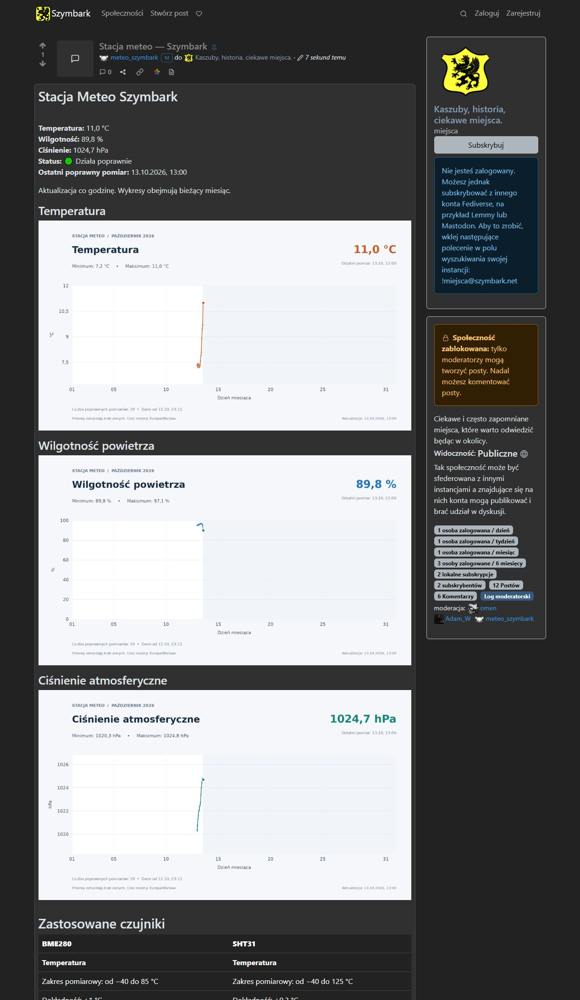

# Uploading server data (meteo) to Lemmy instance

A Python application that reads a physical weather station over **Modbus TCP** and publishes its measurements to a **single, regularly updated Lemmy post**.

It collects temperature, relative humidity and atmospheric pressure, stores the history in SQLite, generates three monthly charts, and uploads the results through Lemmy's API. A standard Linux CRON job runs the complete cycle every hour.

## Features

- Configurable Modbus host, TCP port, device ID and register addresses.
- Holding registers (FC03) or input registers (FC04), with signed or unsigned 16-bit values.
- A separate **multiplier and offset for each measurement**.
- Validation, retries and a short station status: working correctly or station error.
- SQLite history, including failed readings without replacing them with zeroes.
- Three monthly PNG charts: temperature, humidity and pressure.
- Updates to one existing post, preserving the static text outside the managed section.
- Optional community pinning when the publishing account has moderator permissions.
- User-level CRON scheduling, isolated Python dependencies and file locks against overlapping cycles.

## How it works

```text
Modbus TCP device
       |
       v
Read registers -> apply scaling -> validate -> SQLite + latest status
                                                    |
                                                    v
                                           Three monthly charts
                                                    |
                                                    v
                                  Upload images and update one Lemmy post
```

Each value is calculated on the collection server:

```text
measurement = decoded_register * multiplier + offset
```

For example, a register value of `234` with a multiplier of `0.1` becomes `23.4 °C`. Lemmy receives formatted Markdown text and uploaded PNG images, not raw Modbus registers. The current presentation uses Polish labels and decimal commas.

The charts cover the current calendar month in the configured time zone. Missing readings break the plotted lines. Old measurements remain in the database when a new month begins.

## Requirements

- Linux with Python 3.11 or later; validated on Debian 12 with Python 3.11.2.
- Network access to the Modbus device and HTTPS access to the Lemmy instance.
- An active Lemmy account allowed to post in the selected community and upload images.
- **Lemmy API v3**, based on the working Lemmy 0.19.11 deployment. API v4 is not implemented.
- Moderator or administrator permissions only if community pinning is enabled.

The application supports one 16-bit register per measurement. Multi-register floats and custom word order are not implemented. The three registers are read separately, so they do not need to be adjacent; the readings are not a single atomic hardware sample. The program performs no Modbus writes.

No Docker container or incoming web server is required on the collection machine. Installation does not require rebooting the server.

## Installation

### 1. Download the application

Download and extract the package from [Releases](../../releases), or clone this repository:

```bash
git clone https://github.com/adamzend/Uploading-server-data-meteo-to-Lemmy-instance.git meteo
cd meteo
```

### 2. Install the system dependencies and Python environment

```bash
sudo apt-get update
sudo apt-get install python3 python3-venv cron ca-certificates mc
sh install.sh
```

Run `install.sh` as the ordinary Linux user who will run the station. It creates `.venv`, installs the pinned dependencies and copies `config.example.json` to `config.json` if needed. It does **not** enable CRON or publish anything.

### 3. Configure and test the measurements

```bash
mcedit config.json
chmod 600 config.json
.venv/bin/python settings.py
.venv/bin/python -m unittest discover -v
.venv/bin/python meteo.py
.venv/bin/python charts.py
```

Fill in the Modbus host, port, device ID, function code and all three register addresses. Choose the correct signedness and multiplier for each sensor. Leave `lemmy.enabled` set to `false` while testing.

`settings.py` validates configuration without connecting to external services. The test suite uses simulated data and API responses. `meteo.py` performs a real reading and adds it to the database. Check `data/status.json` and the three images in `wykresy/`.

### 4. Configure Lemmy

In `config.json`, enter the instance's canonical HTTPS origin, the publishing account's username and password, and the numeric community ID. Set the post title and heading.

- Leave `post_id` as `null` to find or create the weather post.
- Set `post_id` to update an existing post owned by this account in this community.
- Enable `pin_in_community` only when the account has the required permissions.
- The program authenticates through the API and caches a JWT locally. It does not create accounts or grant permissions. TOTP login is not implemented.

For a new post, you can prepare a static description of your sensors:

```bash
cp static.example.txt static.txt
mcedit static.txt
```

The content of `static.txt` is appended **only when a new post is created**. Edit the static section directly in Lemmy afterward.

For an existing post, place these markers on separate lines with blank lines around the managed content:

```markdown
[meteo-start]: #

Measurements and charts will be inserted here.

[meteo-end]: #

Your permanent sensor description goes here.
```

The program replaces only the section between the markers. Missing, duplicated or reversed markers cause publication to stop instead of replacing the entire post.

Set `lemmy.enabled` to `true`, then run the first complete cycle:

```bash
.venv/bin/python settings.py
.venv/bin/python run_cycle.py
```

Check the resulting post. Its URL is recorded in `logs/meteo.log`, and its ID is saved in `data/lemmy-state.json`.

### 5. Enable hourly updates

```bash
.venv/bin/python install_cron.py
crontab -l
systemctl is-active cron
```

If CRON is disabled:

```bash
sudo systemctl enable --now cron
```

The installer schedules a cycle at the beginning of every hour, preserves unrelated jobs and saves a backup of the previous crontab. It manages one `# meteo-collector` job per Linux user. The schedule follows the server's CRON time zone; chart dates use `timezone` from the application configuration.

To edit the schedule or remove this job:

```bash
EDITOR=mcedit crontab -e
.venv/bin/python install_cron.py --remove
```

When changing the interval, also adjust `stale_after_minutes` and `lemmy.update_note`. Running the installer again restores the hourly schedule.

## Configuration reference

The complete template is [config.example.json](config.example.json).

| Setting | Purpose |
| --- | --- |
| `timezone` | IANA time zone for dates and month boundaries; default `UTC`. |
| `stale_after_minutes` | Maximum acceptable reading age at publication, also the chart gap threshold; default 90. |
| `modbus.host`, `port`, `unit_id` | Device network address, TCP port and Modbus unit ID. |
| `modbus.function_code` | `3` for holding registers or `4` for input registers. |
| `modbus.timeout_seconds`, `attempts`, `retry_delay_seconds` | Timeout and retry controls. |
| `sensors.<name>.address` | Protocol register address, from 0 to 65535. All three must be filled in. |
| `sensors.<name>.signed` | `true` for int16, `false` for uint16. |
| `sensors.<name>.multiplier`, `offset` | Per-sensor conversion applied after decoding the sign. |
| `sensors.<name>.min`, `max` | Valid range of the converted measurement. |
| `lemmy.enabled` | Enables publishing; disabled in the template. |
| `lemmy.instance`, `username`, `password` | Instance origin and publishing account credentials. |
| `lemmy.community_id`, `post_id` | Local community ID and optional existing post ID. |
| `lemmy.title`, `heading`, `update_note` | New post title, in-post heading and update description. |
| `lemmy.pin_in_community` | Requests community pinning; does not grant moderation rights. |

Sensor names are `temperature`, `humidity` and `pressure`. Converted values must be in **°C, %, and hPa**, respectively. Addresses are sent as configured: the application does not automatically subtract 1 or 40001 from a manufacturer's register numbering.

Detailed Polish documentation is also included: [installation and operation](README.txt) and [configuration](KONFIGURACJA.txt).

## Operation and data

| File or directory | Contents |
| --- | --- |
| `run_cycle.py` | Measurement, chart generation and publication in order. |
| `meteo.py` | Modbus reads, conversion, validation and storage. |
| `charts.py` | Monthly charts and their manifest. |
| `publish_lemmy.py` | Authentication, image upload and post updates. |
| `data/` | SQLite history, latest status, JWT, post state and upload history. |
| `wykresy/` | Three PNG charts and their manifest. |
| `logs/` | Application and CRON logs. |
| `.venv/`, `.cache/` | Local Python environment and plotting cache. |

A failed reading is stored as an error. The post can show the last successful values with their timestamp and an error status. If the entire server, network connection or Lemmy API becomes unavailable, the post cannot update itself: check the last measurement time. This status is not an independent external uptime monitor.

Old uploaded chart images are not automatically deleted from pict-rs. Application logs rotate, but `logs/cron.log` does not. Plan storage and backups accordingly.

To migrate, disable the old CRON job and let its current cycle finish, then copy the application, your private configuration and the complete `data/` directory. Recreate the environment with `sh install.sh`, test one cycle and enable CRON on the new server. Do not run two publishers against the same post. For a live SQLite backup, use the SQLite backup API instead of copying only the database file while WAL writes are active.

## Credentials and verification

`config.json` contains your password in plain text and must remain private. It and the generated data, logs and tokens are excluded by `.gitignore`. Do not publish them. The public template has no device address, account credentials or deployment-specific register map.

The first release passed **18 automated tests on Debian 12 / Python 3.11.2**, covering Modbus parsing and retries, scaling, month boundaries, missing measurements, PNG generation and preservation of static post content. Tests use simulated network responses; compatibility with every Lemmy deployment is not implied.

## A real working weather station

This project is not just a theoretical idea. It is based on a **physical, operating weather station that sends real measurements to an active Lemmy instance**. The configurable application in this repository was prepared from that working deployment.

**Live weather post:** [Stacja meteo — Szymbark](https://szymbark.net/post/171)

The screenshot below was captured from the actual public post on 13 October 2026. It shows the measured values, station status and three monthly charts; it is not a mockup.



**Lemmy instance homepage:** [szymbark.net](http://szymbark.net)
